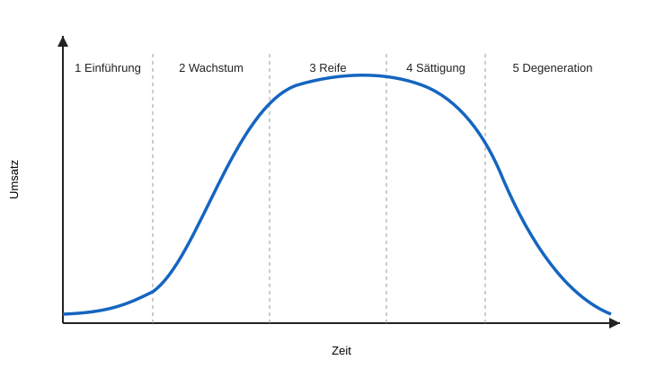

# Produktpolitik

Stand: 2026-11-16 · Status: **Entwurf, Gruppe entscheidet und prüft** · Produkt: App für Wallbox-Sharing (Marktplatz für Wallbox-Kapazität, Gadget kostenlos gegen Pfand, Reservierung)

Die Produktpolitik legt fest, wie das Unternehmen sein Produkt- und Leistungsspektrum marktgerecht gestaltet. Alle Aussagen zum Wallbox-Sharing unten sind **Vorschläge zur Diskussion**, keine Beschlüsse. Verbindlich bleiben die Beschlüsse in `kapitel/00d-geschaeftsmodell-zielmarkt-beschluesse.md`. Die noch offene Dienstleistung wird nicht festgelegt, sondern als Option benannt.

---

## 1. Session-Plan (heutige Session, 2026-11-16)

In dieser Session sollen folgende Punkte erledigt werden:

| Nr. | Punkt | Status |
|---|---|---|
| 1 | Absatzsteigerung | Entwurf, vertieft (Abschnitt 2.1) |
| 2 | Gewinnung neuer Kunden | Entwurf, vertieft (Abschnitt 2.1) |
| 3 | Bindung vorhandener Kunden | Entwurf, vertieft (Abschnitt 2.1) |
| 4 | Positives Image schaffen | Entwurf, vertieft (Abschnitt 2.1) |
| 5 | Bessere Positionierung auf dem hart umkämpften Markt | Entwurf, vertieft (Abschnitt 2.1) |
| 6 | Serviceleistung anbieten | Entwurf, vertieft (Abschnitt 2.1) |
| 7 | Angemessene Garantieleistungen | Entwurf (Abschnitte 2 und 9) |
| 8 | Beachtung des Produktlebenszyklus (Umsatz über Zeit) | Recherchiert, mit Maßnahmen je Phase (Abschnitt 3) |
| 9 | Technische Eigenschaften | Entwurf (Abschnitt 4), Machbarkeit ungeprüft |
| 10 | Verpackung | Entwurf (Abschnitt 5) |
| 11 | Service | Entwurf (Abschnitt 6) |
| 12 | Markenbildung | Entwurf (Abschnitt 7) |
| 13 | Sortimentszusammenhang | Entwurf (Abschnitt 8) |
| 14 | Garantie | Entwurf (Abschnitt 9), rechtlich zu prüfen |

Hinweis: Service (11) und Garantie (14) überschneiden sich mit den Punkten 6 und 7; bei der Ausarbeitung zusammenführen. „Verpackung“ betrifft beim Gadget die physische Verpackung, bei der App die Darstellung (Store-Auftritt).

---

## 2. Bestandteile der Produktpolitik (Entwurf für Wallbox-Sharing)

| Ziel | Ansatz (Vorschlag) | Verknüpfung |
|---|---|---|
| **1 Absatzsteigerung** | Mehr Buchungen je Ladepunkt (Reservierung, Verfügbarkeit); Anbieter-Akquise mit Schwerpunkt PV; Erweiterung um gewerbliche Ladepunkte | Beschluss I (Marktplatz), Phasen 2027–2031 |
| **2 Neue Kunden gewinnen** | Fahrer ohne Wallbox an der Wohnung (Kern F1); Anbieter alle Wallbox-Besitzer; Pilot Stadt und Land parallel | Kunden/Personas (`01a`, `01b`) |
| **3 Kunden binden** | Planbarkeit durch Reservierung, verlässliche Anbieter, einfache Abwicklung; Bindungsinstrumente (z. B. Bewertungen, Stammanbieter) als Optionen prüfen; Abos nur als Vermerk nach dem Pilot | Beschluss: Abos erst nach Pilot |
| **4 Positives Image** | Image aus Verlässlichkeit, Sicherheit, Fairness; „rundum sorglos“ für Anbieter. Keine Preisversprechen ohne Beleg | Nutzenversprechen laut Beschluss |
| **5 Bessere Positionierung** | USP: Gadget + Reservierung; nie „erste“ oder „einzige“; Vorbehalt Eichrecht und Machbarkeit; Abgrenzung zu Ladenetzen und anderen Sharing-Plattformen | Porter-Analysen (`03b`), SWOT (`03c`) |
| **6 Serviceleistung** | Die noch offene **Dienstleistung** ist hier einzuordnen. Optionen mit Empfehlung vorlegen und mit der Gruppe entscheiden (nichts erfinden) | offene Frage laut CLAUDE.md |
| **7 Garantieleistungen** | Für das Gadget (Funktion, Austausch bei Defekt, Pfandrückgabe) und für die Vermittlung (z. B. Versicherungs-/Haftungsfragen). Umfang rechtlich prüfen, gesetzliche Gewährleistung als Untergrenze | Kapitel 6 Recht |
| **8 Produktlebenszyklus** | Maßnahmen je Phase, siehe Abschnitt 3 | Meilensteine (Kapitel 9) |

### 2.1 Vertiefung der Ziele 1 bis 5

Grundlage: `kapitel/01a-kunden.md`, `kapitel/00d-…`, `recherche/wettbewerber.md`, `kapitel/03c-swot-analyse.md`, Annahmen A-06, A-08, A-11, A-18. Zahlen stehen nur mit Quelle oder Annahme-ID; wo beides fehlt, ist es offen.

#### Ziel 1: Absatzsteigerung
Absatz heißt hier **vermittelte kWh und Reservierungen** (Provision im Preis enthalten, Reservierungsgebühr bei Nichtnutzung). Der Marktplatz wächst nur, wenn beide Seiten wachsen.

| Hebel | Maßnahme (Vorschlag) | Kennzahl für den Pilot | Hinweis |
|---|---|---|---|
| Anbieterzahl | Akquise mit Schwerpunkt PV (A-11); Gadget kostenlos gegen Pfand senkt die Einstiegshürde | aktive Anbieter je Region (A-06 Mindestzahl) | Teilungsbereitschaft der Besitzer ist Annahme (A-08) |
| Auslastung je Wallbox | freie Zeitfenster klar anzeigen, Reservierung, Radar | gebuchte Stunden je Wallbox (A-12 freie Stunden) | Auslastung ist unbelegt |
| Fahrernutzung | Zielgruppe F1 gezielt ansprechen; Erinnerung an wiederkehrende Ladefenster | Anteil aktiver Fahrer (A-18), kWh je Fahrer (A-19) | A-18 ist der größte Hebel laut Glossar, aber nicht belegt |
| Preisstellung | zwei kWh-Preise (PV, Normal) innerhalb einer Spanne | Preis-Akzeptanz im Pilot | kein Preisversprechen; Spanne A-14 offen |
| Zusatzleistungen | Reservierungsgebühr (Pilot), später Abo, Partnerprovisionen, Energie-Services | Anteil Zusatzerlöse | erst nach Pilot |

#### Ziel 2: Gewinnung neuer Kunden
Zwei Seiten, zuerst Anbieter (Gadget-Verteilung), dann Pilot mit beiden Seiten gleichzeitig (`01a`).

| Seite | Zielgruppe | Kanäle (Vorschlag, ungeprüft) | Botschaft |
|---|---|---|---|
| Anbieter | alle Wallbox-Besitzer, Schwerpunkt PV | PV-Installateure, Stadtwerke, Hausverwaltungen (Kandidaten, nicht geprüft), lokale Ansprache im Pilotgebiet, Empfehlung | „rundum sorglos“; Einnahmen nur als Möglichkeit |
| Fahrer | Fahrer ohne Wallbox an der Wohnung (Kern F1: Mieter), Land und Stadt | Wohnumfeld, lokale Gruppen, Arbeitgeber, Social Media, Stadt und Land parallel testen | „planbar und nah“, „verfügbar, wo Säulen fehlen“ |

- Pilotregionen: Stadt Mannheim–Heidelberg, Land Odenwald (laut `01a`). Spannung: Mieter sitzen eher in der Stadt, Wallboxen stehen eher auf dem Land; im Pilot prüfen.
- Henne-Ei-Problem: Ohne Anbieter keine Fahrer. Deshalb Mindestzahl aktiver Anbieter vor Fahrerstart (A-06).
- Wirksamkeit der Kanäle und Kosten je Neukunde sind offen; erst im Pilot messen (Kapitel Marketing und Vertrieb).

#### Ziel 3: Bindung vorhandener Kunden
| Instrument | Fahrer | Anbieter | Hinweis |
|---|---|---|---|
| Verlässlichkeit | Reservierung hält, Alternativvorschlag bei Ausfall | pünktliche Auszahlung, transparente Abrechnung | Kernbindung, keine Zusatzkosten |
| Komfort | gespeicherte Zahlungsmittel, Lieblingsstandorte | Zeitfenster-Vorlagen, Übersicht | App-Funktionen |
| Vertrauen | Bewertungen, Versicherung | Versicherung, Support | D-3 |
| Anreize | später Premium-Abo/Rabatt für Vielnutzer (E-2) | – | erst nach Pilot; nicht vor Beleg einplanen |
| Gemeinschaft | feste Ladepartnerschaften (Stammgast-Funktion, Option) | Stammkunden | prüfen, Datenschutz beachten |
| Pfand | – | Pfand schafft Verbindlichkeit, aber auch Hürde | Wirkung im Pilot testen (zwei Höhen, A-03) |

Abwanderungsgründe sammeln (Befragung beim Abmelden) und Kennzahlen wie Wiederbuchungsrate festlegen (Zielwerte als Annahmen).

#### Ziel 4: Positives Image schaffen
- **Image-Ziel:** verlässlich, fair, nachbarschaftlich, nachhaltig (Markenkern Abschnitt 7.2).
- **Wirkungshebel:** funktionierende Reservierung, saubere Abrechnung, schneller Support, offener Umgang mit Fehlern.
- **Nachhaltigkeit:** vorhandene Wallboxen besser auslasten, statt neue Ladeinfrastruktur zu bauen (Beschluss I.1). Nur Aussagen, die belegt sind (kein „spart CO₂“ ohne Rechnung).
- **Vertrauen:** Datenschutz, EU-Hosting, Versicherungspartner (nur nach Vertrag), transparente Preise inkl. Reservierungsgebühr.
- **Risiken fürs Image:** Schäden oder Streit zwischen Nachbarn, Ausfälle der Reservierung, Datenpannen; Gegenmaßnahmen Abschnitte 6 und 9.
- **Werbung:** keine Preisversprechen, nie „erste“/„einzige“ (Wettbewerbsrecht, Abmahngefahr).

#### Ziel 5: Bessere Positionierung auf dem hart umkämpften Markt
Wettbewerb nach `recherche/wettbewerber.md` und `kapitel/03b-porter-five-forces.md` (zwei getrennte Analysen: Laden, Sharing-Plattformen).

| Wettbewerber/Gruppe | Belegte Stärke | Folge für die Positionierung |
|---|---|---|
| Cocharge | Abrechnung, Auszahlung, Support, Anmeldung; verlangt eichrechtskonforme Station | Service allein ist kein Alleinstellungsmerkmal |
| AirElectric | kostenlos, werbefrei, Destination Charger, Karte | Radar ist nicht per se neu |
| &Charge (Stand 2021, Status unklar) | Reservierung, jede handelsübliche Wallbox | Reservierung ist nicht neu |
| VoltExchange (seit 2026-07-29) | Community, kWh-Guthaben statt Geld | anderes Modell (Tausch), Mieter nur mit Beitrag |
| Öffentliche Ladenetze | breite Abdeckung | Substitut; Nutzenversprechen „nah und planbar“ statt Preisvergleich |

**Positionierung (Vorschlag):** Marktplatz für Wallbox-Kapazität in Wohnortnähe, der **bestehende Wallboxen per Gadget** anschließt und Fahrern ohne eigene Lademöglichkeit **reservierbare Ladefenster** bietet, mit Rundum-Service für Anbieter. Der Unterschied liegt in der Kombination, nicht in Einzelmerkmalen (Beschluss I.7).
- **Vorbehalte:** Gadget-Machbarkeit und Eichrecht ungeprüft (Abschnitt 4); Wettbewerber ändern sich (Stand und Abruf prüfen).
- **Positionierungsaussage ohne** „erste“, „einzige“, Preisvorteil.
- Nächster Schritt: Kundenbefragung zur Relevanz von Reservierung und Gadget (Umfrage laut `recherche/umfrage-interviewleitfaden.md`).

---

## 3. Produktlebenszyklus (Umsatz über Zeit)

*Schematische Darstellung, keine Prognose; Kurvenverlauf idealtypisch.*

### Phasen (klassisches Fünf-Phasen-Modell)

| Phase | Umsatz | Gewinn | Typische Maßnahmen |
|---|---|---|---|
| 1 Einführung | niedrig, langsam steigend | meist negativ; Phase endet am Break-even | Werbung und PR für Bekanntheit |
| 2 Wachstum | stark steigend | erste Gewinne | Vertriebskanäle ausbauen, Produktverbesserungen und Varianten |
| 3 Reife | Wachstum flacht ab, Maximum | sinkende Wachstumsrate, Gewinn sinkt; Preiskampf | Produktdifferenzierung, Angebotserweiterung |
| 4 Sättigung | stagniert | Margen sinken, hoher Werbeaufwand | Preisanreize, Rationalisierung |
| 5 Degeneration (Rückgang) | sinkt | sinkt | Produkt eliminieren oder neu ausrichten (neuer Zyklus möglich) |

Anmerkungen aus den Quellen: Die Phasen sind idealtypisch und nicht eindeutig abgrenzbar. Es gibt auch Vier-Phasen-Modelle (Sättigung wird dem Rückgang zugeordnet) und Sechs-Phasen-Modelle.

### Anwendung auf Wallbox-Sharing (Vorschlag)
- Pilotphase und Start 2027 entsprechen der **Einführung**: Fokus auf Bekanntheit und Anbieter-Akquise, Verluste einplanen (Zahlen aus dem Finanzplan, nicht hier erfinden).
- Zu klären (Annahme, noch zu belegen): in welcher Phase der Markt für Wallbox-Sharing insgesamt steht, und ob der Marktplatz erst mit ausreichend Anbietern und Fahrern („Netzwerkeffekt“) ins Wachstum kommt.
- Lebenszyklus verlängern durch Phase-2-/3-Erweiterungen (gewerbliche Ladepunkte, DACH als Option, Abos nach dem Pilot).

### Maßnahmen je Phase für Wallbox-Sharing (Vorschlag)
| Phase | Ziele | Maßnahmen | Kennzahlen (Annahmen noch offen) |
|---|---|---|---|
| 1 Einführung (Pilot 2027) | Anbieter und Fahrer in zwei Regionen gewinnen, Machbarkeit beweisen | Gadget-Verteilung, lokale Akquise, MVP (D-1, D-2), Support per App/E-Mail | aktive Anbieter (A-06), Buchungen, Pfandrückgabe, Fehlerquote |
| 2 Wachstum | Anbieterdichte und Nutzung steigern | weitere Regionen, gewerbliche Ladepunkte, Partnerkanäle, Energie-Services (D-4), Abo | Nutzerzahl, Auslastung, Provisionserlös |
| 3 Reife | Marktführung in Regionen sichern | Differenzierung (Service, Qualität), Kooperationen, DACH-Option prüfen | Marktanteil, Kundenbindung |
| 4 Sättigung | Margen halten | Effizienz, Preisanreize, Zusatzleistungen | Marge, Abwanderung |
| 5 Degeneration | Erneuerung | neue Geschäftsfelder oder Neuausrichtung | Umsatzrückgang, Alternativen |

Zeitliche Lage und Dauer der Phasen sind **nicht prognostiziert**; die Kurve ist schematisch.

### Quellen (Abruf 2026-11-16)
- WHK Controlling, „Produktlebenszyklus: 5 Phasen erklärt“: https://www.whk-controlling.de/wissen/produktlebenszyklus
- Agicap, „Welche Phasen gibt es im Produktlebenszyklus?“: https://agicap.com/de/artikel/produktlebenszyklus/
- ZUM.de, „Produktlebenszyklus Phasen Merkmale“: https://www.zum.de/Faecher/kurse/boeing/udb/abs/Produktlebenszyklus-Phasen-Merkmale.pdf
- ZUM.de, „Produktlebenszyklus Massnahmen“: https://www.zum.de/Faecher/kurse/boeing/udb/abs/Produktlebenszyklus-Massnahmen.pdf

Hinweis: Die Angaben stammen aus Suchergebnis-Auszügen; die Seiten wurden nicht vollständig gelesen. Vor Übernahme in die Abgabe die Quellen prüfen.

---

## 4. Technische Eigenschaften (Entwurf, 2026-11-16)

Grundlage: `kapitel/02-produkt-dienstleistung.md` (D-1 bis D-7), `kapitel/00d-…` (I.5–I.7, Punkt 7 Eichrecht), `recherche/swot-recherche.md` (SW-01, SW-04). **Vorbehalt:** Die technische Machbarkeit und das Eichrecht des Gadgets sind ungeprüft (Beschluss I.7). Alle Anforderungen unten sind Vorschläge; Zahlen (Kosten, Reichweite, Zeiten) stehen bewusst nicht drin, bis Angebote oder Annahmen (A-nn) vorliegen.

### 4.1 Gadget (Hardware)

Aufgabe: Eine bestehende Wallbox des Anbieters teilbar machen, ohne dass dieser eine neue Wallbox kaufen muss. Das Gadget wird nach Registrierung kostenlos gegen Pfand zugeschickt (Auftragsfertigung nach eigenem Design, EU-Hosting der Daten).

**Funktionale Anforderungen (Vorschlag):**

| Nr. | Anforderung | Zweck |
|---|---|---|
| T-1 | Ladefreigabe aus der Ferne (starten, beenden) | nur der gebuchte Fahrer kann laden |
| T-2 | Messung der geladenen Energie in kWh mit Start, Ende, Dauer | Abrechnung nur nach kWh (Beschluss Punkt 7), Nachweis bei Streit |
| T-3 | Internetanbindung (WLAN, Rückfall-Möglichkeit prüfen) und verschlüsselte Kommunikation zur App | Reservierung, Abrechnung |
| T-4 | Zeitfenster und Reservierung (30 Minuten) technisch durchsetzen | Nutzenversprechen „planbar“ |
| T-5 | Laststeuerung und Sicherheitsabschaltung (Überlast, Fehlerstrom) bleiben bei der vorhandenen Wallbox | keine neue elektrische Gefahrenquelle |
| T-6 | Manipulationsschutz (Plombe, Erkennung von Entfernen) | Eichrecht, Pfandrückgabe |
| T-7 | Einfache Installation, möglichst ohne Elektriker; sonst Installationsservice (D-5) | Nutzenversprechen „rundum sorglos“ |
| T-8 | Firmware-Updates aus der Ferne, signiert | Sicherheit, spätere Dienste (D-4: PV-Überschuss, Strompreis) |
| T-9 | CE-Konformität, Zertifizierung | Voraussetzung für Marktzugang |

**Anschlussvarianten (Optionen):**

| Option | Prinzip | Vorteile | Nachteile / Risiken |
|---|---|---|---|
| A: Software-Anbindung | Gadget oder App spricht die Wallbox über deren Schnittstelle an (OCPP, Modbus, MQTT, HTTP) | kein Eingriff in die Elektrik | Schnittstelle muss vom Hersteller dokumentiert und freigeschaltet sein; Umfang je Hersteller verschieden; nicht jede Wallbox unterstützt es |
| B: Zwischenstecker/Zwischenschalter mit Zähler im Stromkreis | Schaltet und misst vor der Wallbox (z. B. Hutschiene) | funktioniert bei vielen Wallboxen unabhängig vom Hersteller | Einbau durch Elektrofachkraft nötig; Eichrecht und Zähler-Zulassung klären; passt weniger zu „einstecken“ |
| C: Kombination | A, wo möglich; sonst B | größte Abdeckung | höchste Komplexität und Kosten |

**Empfehlung zur Diskussion:** Mit Option A für wenige, gut dokumentierte Wallbox-Modelle starten (Pilot), parallel Option B auf Machbarkeit und Eichrecht prüfen. Das bestehende Produktversprechen „jede bestehende Wallbox teilbar“ (USP) steht damit unter dem Vorbehalt der Kompatibilität; im Text nur „viele gängige Wallboxen“ sagen, bis eine Kompatibilitätsliste belegt ist.

**Recherchestand zur Machbarkeit (Abruf 2026-11-16, Aussagen überwiegend von Herstellern und Ratgebern, nicht von Gesetzestexten):**
- Viele Wallboxen bieten Schnittstellen wie MQTT, HTTP, Modbus TCP und OCPP sowie RFID-Freischaltung ab Werk (z. B. WARP-Wallbox laut Betriebsanleitung: https://www.warp-charger.com/documents/WARP3_Betriebsanleitung.pdf).
- Die Schnittstelle kann herstellerseitig abgeschaltet oder erst auf Anfrage aktiviert sein (Beispiel Fox ESS: https://helpdesk.stromdynamisch.swo.de/hc/en-us/articles/33949897322898-Fox-ESS-Wallbox); nicht alle Wallboxen halten den OCPP-Standard vollständig ein (evcc-Doku: https://docs.evcc.io/de/chargers/ocpp-1-6j-compatible).
- Ein **fertiges Nachrüst-Gadget** für beliebige Wallboxen wurde **nicht gefunden**. Das passt zu `recherche/wettbewerber.md` („kein Wettbewerber mit Gadget“). Das ist eine Chance, aber auch ein Hinweis auf technischen Aufwand; **nicht als Vorteil behaupten, bis geprüft**.

**Eichrecht (Vorbehalt, siehe SW-01, SW-04):**
- Bei Abrechnung an unbekannte Dritte reicht ein MID-Zähler allein laut Ratgebern nicht; das Gesamtsystem inklusive manipulationssicherer Datenkette muss eichrechtskonform sein (https://www.navit.com/blog-de/eichrechtskonformes-laden-zu-hause, https://www.adac.de/fahrzeugwelt/wallbox/eichrechtskonform/).
- Übliche Nachrüstung: separater MID-Zähler im Stromkreis (https://42watt.de/magazin/zwischenzaehler). Ob ein Gadget das eichrechtskonform leisten kann, ist **offene Prüfaufgabe**; verbindliche Auskunft bei der zuständigen Eichbehörde einholen.
- Folge für den Pilot: nur kWh-Abrechnung, keine Zeit- oder Pauschaltarife.

### 4.2 App (Software)

| Bereich | Funktionen (Vorschlag) | Bezug |
|---|---|---|
| Fahrer | Registrierung, Wallbox-Radar (Karte), Reservierung im Zeitfenster, Start/Ende des Ladens, Zahlung, Bewertung, Support | D-1, D-2, D-6 |
| Anbieter | Registrierung, Gadget-Bestellung und Einrichtung, Zeitfenster und Zugang selbst festlegen, Preis innerhalb der Spanne (PV oder Normal), Auszahlung, Versicherungs- und Support-Zugang | D-1 bis D-5 |
| Anbieter und Fahrer in einem Konto | Rollenwechsel in derselben App | `02`, 2.1 |
| Backend | Marktplatzlogik (eigen), Abrechnung, Zahlung, Ladepunkt-Backend (zugekauft); Hosting in der EU | Beschluss I.5 |
| Später | Energie-Services (PV-Überschuss, Strompreis), Abos | D-4, nach Pilot |

MVP laut Beschluss I.5: Vermittlung (D-1) und Abrechnung (D-2).

### 4.3 Nichtfunktionale Anforderungen

- **Datenschutz:** DSGVO-konform, Datenminimierung (Standort, Ladedaten, Zahlungsdaten), EU-Hosting; Rechtsprüfung offen.
- **Zahlungssicherheit:** Zahlung über Zahlungsdienstleister (noch keiner gewählt, `recherche/zahlungsdienstleister.md`); keine Kartendaten im eigenen System.
- **Verfügbarkeit und Fehlerfall:** Verhalten bei Internetausfall festlegen (Ladevorgang sicher beenden oder zu Ende laufen lassen; Messdaten zwischenspeichern).
- **Plattformen:** iOS und Android; Umfang im MVP festlegen.

### 4.4 Offene Fragen und nächste Schritte

1. Wallbox-Modelle mit offener Schnittstelle auflisten und Anteil im Bestand belegen (Basis: `recherche/private-wallboxen-deutschland.md`; Marktanteile der Hersteller ggf. nicht vorhanden, dann offen sagen).
2. Auskunft der Eichbehörde zum Gadget einholen (Option A und B).
3. Kosten Gadget: Herstellkosten pro Anbieter (A-02) per Angebot; daran hängt die Pfandhöhe (A-03).
4. Elektrosicherheit und Haftung bei Option B mit Rechtsprüfung klären.
5. Gruppenentscheidung: Optionen A/B/C und Pilot-Wallbox-Modelle.

---

## 5. Verpackung (Entwurf, 2026-11-16)

Gilt für das **Gadget** (physische Verpackung, Versand, Rückgabe) und die **App** (Auftritt im Store). Alle Punkte sind Vorschläge; Kosten und Mengen stehen nicht drin, bis Angebote oder Annahmen (A-nn) vorliegen. Hängt von der Gadget-Bauform ab (Abschnitt 4, Option A oder B).

### 5.1 Aufgaben der Gadget-Verpackung

| Nr. | Aufgabe | Vorschlag |
|---|---|---|
| V-1 | Schutz beim Versand | stoß- und feuchtigkeitsfest; Elektronik gegen Beschädigung sichern |
| V-2 | Erste Installation erleichtern | Kurzanleitung mit QR-Code zur App-Einrichtung, Sicherheitshinweise; bei Option B klarer Hinweis auf Einbau durch Elektrofachkraft |
| V-3 | Pfandkonzept sichtbar machen | Hinweis „kostenlos gegen Pfand“, Rückgabebedingungen und Pfandrückerstattung in der Packung; Pfandhöhe wird im Pilot getestet (A-03), daher keine feste Zahl aufdrucken |
| V-4 | Rückgabe ermöglichen | Verpackung mehrfach nutzbar mit vorbereiteter Rücksendung (Retourenaufkleber), damit Gadget zurückkommt und Pfand erstattet werden kann |
| V-5 | Manipulationsschutz | Siegel/Plombe, die den Einbau- und Öffnungszustand zeigt (Verknüpfung mit T-6, Eichrecht) |
| V-6 | Marke vermitteln | Auftritt gemäß Markenbildung (Abschnitt 7); Name, Logo und Farben erst nach Entscheidung |
| V-7 | Ressourcenschonend | möglichst wenig Material, recycelbar; passt zum Image (Punkt 4) |

### 5.2 Rechtliche Pflichten (zu prüfen, nicht abschließend)

- **Verpackungsgesetz:** Wer Versandverpackungen erstmals befüllt und in Verkehr bringt, muss sich bei LUCID registrieren und an einem dualen System beteiligen (Lizenz); sonst droht Vertriebsverbot und Bußgeld. Die Registrierung ist laut Händlerbund kostenlos, muss vom Unternehmen selbst erfolgen. Wer „Hersteller“ ist (wir oder der Fulfillment-Dienstleister), ist zu klären. Quellen: https://www.haendlerbund.de/de/ratgeber/recht/4162-verpackg-registrieren-lizenzieren, https://www.ihk.de/hagen/servicemarken/branchen/einzelhandel/das-neue-verpackungsgesetz-konsequenzen-fuer-haendler-4262638 (Abruf 2026-11-16, Ratgeber/Kammer-Seiten, Auszüge). **Hinweis:** Ein Artikel nennt Änderungen ab August 2026; Stand direkt bei der Zentralen Stelle Verpackungsregister prüfen.
- **Elektrogerätegesetz (ElektroG) und Registrierung bei der stiftung ear:** Das Gadget ist ein Elektrogerät. Ob und welche Pflichten (Registrierung, Rücknahme, Kennzeichnung mit durchgestrichener Mülltonne) gelten, ist **nicht recherchiert** (Suche ergab keine Treffer) und muss geprüft werden.
- **Batterien:** Falls das Gadget Batterien enthält, gelten gesonderte Pflichten; Klärung abhängig vom Design.
- **CE-Kennzeichnung und Anleitung:** Kennzeichnung und Sicherheitshinweise gehören auf bzw. in die Verpackung (siehe T-9).
- **Pfand:** Das Gadget-Pfand ist ein vertragliches Pfand, kein gesetzliches Pfand wie Einwegflaschen (Einschätzung, juristisch bestätigen).

### 5.3 App-Auftritt im Store

- Name, Icon, Beschreibung und Screenshots nach Markenvorgaben (Punkt 12).
- Kurztext nach dem Nutzenversprechen: Fahrer „planbar und nah“, Anbieter „rundum sorglos“; **kein Preisversprechen**, kein „erste“ oder „einzige“ (Beschluss I.3, I.7).
- Datenschutz-Angaben und Altersangaben der Stores beachten.

### 5.4 Optionen zur Entscheidung

| Option | Beschreibung | Vorteil | Nachteil |
|---|---|---|---|
| A: Minimalpackung | Einfacher Karton, Anleitung, Retoure-Label | geringe Kosten | wenig Markenwirkung |
| B: Mehrweg-Box | Stabile Rückversandbox, mehrfach nutzbar | Rückgabe sicher, Image „nachhaltig“ | höhere Stückkosten, Logistikaufwand |
| C: Markenbox | Hochwertiger Auftritt, QR-Setup | starke Markenwirkung | höhere Kosten, für Pilot ggf. übertrieben |

**Empfehlung zur Diskussion:** Im Pilot Option A mit vorbereiteter Retoure (V-4) und Siegel (V-5); Mehrweg-Box prüfen, sobald die Rückgabequote aus dem Pilot bekannt ist.

### 5.5 Nächste Schritte
1. Verpflichteten für Verpackungsgesetz und ElektroG klären (wir oder Fulfillment-Dienstleister) und Rechtsprüfung beauftragen.
2. Angebote für Verpackung und Rückversand einholen (Kosten als Annahme in `ANNAHMEN-GLOSSAR.md`).
3. Gruppenentscheidung: Option A/B/C und Rückgabeprozess.

---

## 6. Service (Entwurf, 2026-11-16)

Grundlage: `kapitel/02-produkt-dienstleistung.md` (D-1 bis D-7), Beschlüsse I.3, I.5–I.7, `kapitel/05a-ressourcen.md`. Der Service ist der Kern des Versprechens „rundum sorglos“ für Anbieter und ein Teil des USP (Gadget + Reservierung mit Rundum-Service). Die Punkte 6 (Serviceleistung) und 11 (Service) aus dem Session-Plan sind hier zusammengeführt. Alle Vorschläge sind Entwürfe; Kosten, Preise und Zeiten stehen nicht drin, bis Belege oder Annahmen (A-nn) vorliegen.

**Hinweis zur Einordnung:** `CLAUDE.md` nennt die Dienstleistung zum digitalen Produkt noch als offene Frage, `02` und Beschluss I.6 führen D-1 bis D-7 als beschlossen. Die Gruppe sollte bestätigen, ob damit die „Dienstleistung“ des Projekts definiert ist (Empfehlung: ja, mit Schwerpunkt auf D-3 und D-5).

### 6.1 Serviceleistungen im Überblick

| Nr. | Service | Für wen | Inhalt | Stand |
|---|---|---|---|---|
| D-1 | Vermittlung | beide | Zusammenbringen von Fahrer und Anbieter, Reservierung (30 Minuten) | beschlossen, MVP |
| D-2 | Abrechnung und Zahlung | beide | automatische Abrechnung nach kWh, Auszahlung an Anbieter | beschlossen, MVP; Zahlungsdienstleister offen |
| D-3 | Versicherung und Support | beide | geteilte Police über Partnerversicherer (Schäden an Wallbox/Grundstück, Haftung beim Laden); Support über In-App-Hilfe und E-Mail, kein Telefon im Pilot | beschlossen, Partner und Policen offen |
| D-5 | Gadget-Lieferung und Einrichtung | Anbieter | kostenlos gegen Pfand, Versand, Einrichtungsanleitung; bei Bedarf Installationsservice | beschlossen |
| D-6 | Wallbox-Radar | Fahrer | Karte mit verfügbaren Wallboxen | beschlossen |
| D-4 | Energie-Services | Anbieter | PV-Überschuss einbinden, Ladezeit nach Strompreis | erst nach dem Pilot |
| D-7 | Weitere | – | später möglich | offen |

### 6.2 Service entlang der Kundenreise (Vorschlag)

| Phase | Fahrer | Anbieter |
|---|---|---|
| Vor der Nutzung | Radar, verständliche Preisanzeige (kWh-Preis), Hilfetexte | Information zu Ablauf, Pfand, Versicherung, Rechtsfragen (z. B. Steuer, Eichrecht) im Überblick |
| Anmeldung | einfache Registrierung, Zahlungsmittel hinterlegen | Registrierung, Gadget-Bestellung, Pfandzahlung |
| Einrichtung | – | Anleitung per App, Videohilfe, Kompatibilitätsprüfung; Installationsservice als Option (D-5) |
| Nutzung | Reservierung, Navigation, Start/Ende, Beleg | Zeitfenster, Zugang und Preis selbst bestimmen, Auszahlung, Übersicht |
| Störung | Hilfe bei Nichtverfügbarkeit (Alternativvorschlag), Schadensmeldung | Hilfe bei Ausfall des Gadgets (Austausch), Schadensmeldung |
| Danach | Bewertung | Rückgabe Gadget, Pfanderstattung (A-03) |

### 6.3 Support-Optionen

| Option | Beschreibung | Vorteil | Nachteil |
|---|---|---|---|
| A: App und E-Mail (Beschluss Pilot) | In-App-Hilfe, FAQ, E-Mail | geringe Kosten, leicht skalierbar | langsame Reaktion bei dringenden Fällen (z. B. blockierte Wallbox) |
| B: A plus Chat | Ticket-/Chatfunktion mit definierten Reaktionszeiten | schnellere Hilfe | Personalaufwand |
| C: A plus Notfallnummer | Telefon nur für dringende Fälle | Sicherheit im Störfall | Kosten, Besetzung |

**Empfehlung zur Diskussion:** Pilot wie beschlossen mit Option A; Reaktionszeit als Ziel festlegen (Wert als Annahme, nicht aus dem Nichts). Für den Notfall (Schaden, Wallbox blockiert) einen klar gekennzeichneten Eskalationsweg per E-Mail/App-Hinweis einplanen; Option C erst prüfen, wenn der Pilot Bedarf zeigt.

### 6.4 Service-Prinzipien (Vorschlag)

- **Verlässlichkeit vor Preis:** Der Service stützt „planbar und nah“; kein Preisversprechen (Beschluss I.3).
- **Klare Verantwortung:** Wer haftet bei Schäden? Police, AGB und App-Texte müssen das eindeutig sagen (Rechtsprüfung offen).
- **Transparenz:** Preis, Gebühren (Reservierungsgebühr bei Nichtnutzung) und Pfand vor Buchung anzeigen; Zulässigkeit der Reservierungsgebühr ist offen (Z-11 in `05a-ressourcen.md`).
- **Daten sparsam:** nur nötige Daten erheben (siehe Abschnitt 4.3).
- **Messbare Qualität:** Kennzahlen im Pilot erheben (z. B. Anteil erfolgreicher Reservierungen, Zeit bis zur Antwort, Zufriedenheit); Zielwerte als Annahmen in `ANNAHMEN-GLOSSAR.md`.

### 6.5 Abgrenzung zum Wettbewerb (nur mit Belegen)

Laut `recherche/wettbewerber.md` bietet Cocharge Abrechnung und Support; Reservierung ist nicht neu (&Charge). Der Service allein ist daher **kein** Alleinstellungsmerkmal. Neu ist (laut bisheriger Recherche) die Kombination mit dem Gadget. Formulierung weiter ohne „erste“ oder „einzige“.

### 6.6 Offene Fragen und nächste Schritte

1. Partnerversicherer und Policen-Details klären (Deckung, Selbstbehalt, Schadensprozess; Z-12 in `05a`).
2. Personalbedarf für Support abschätzen (Annahme) und im Finanzplan hinterlegen.
3. Installationsservice: eigenes Angebot oder Partner (Elektriker, Fulfillment)? Kosten per Angebot.
4. Rechtsprüfung: Haftung, Reservierungsgebühr, Datenschutz.
5. Gruppenentscheidung: Support-Option A/B/C, Bestätigung der Dienstleistungsdefinition (siehe Hinweis oben).

---

## 7. Markenbildung (Entwurf, 2026-11-16)

Grundlage: `kapitel/00b-elevator-pitch.md` (Abschnitt 7: Namensvorschläge, alle ungeprüft), Beschlüsse I.3 und I.7, `kapitel/03c-swot-analyse.md`. Markenbildung stützt die Produktpolitikziele Image (4) und Positionierung (5). Name, Claim und Farben sind Gruppenentscheidungen; dieser Abschnitt legt Rahmen und Optionen vor.

### 7.1 Ausgangslage
- **Arbeitsname:** **WallShare** (Namensvorschlag N-2, von Ben vorläufig gewählt, Gruppenentscheid steht aus).
- **Nicht geprüft:** Markenrecht (DPMA, EUIPO, WIPO), Domains, App-Stores. Die Websuche vom 2026-11-02 war kein Clearing. Prüfung liegt bei R4 Gregor.
- Risiko: „WallShare“ ist stark beschreibend (Wallbox + Teilen) und klingt an den Hersteller Wallbox Chargers an. Beschreibende Namen sind schwerer als Marke schützbar (Einschätzung aus `00b`, juristisch zu bestätigen).

### 7.2 Markenkern (Vorschlag)

| Baustein | Vorschlag | Beleg im Repo |
|---|---|---|
| Marktrolle | Marktplatz für Wallbox-Kapazität; keine eigene Ladeinfrastruktur | Beschluss I.1 |
| Versprechen Fahrer | planbar und nah: reservieren statt suchen; verfügbar, wo Säulen fehlen | Beschluss I.3 |
| Versprechen Anbieter | rundum sorglos: Abrechnung, Versicherung, Support, Gadget gegen Pfand | Beschluss I.3 |
| Werte | Verlässlichkeit, Nachbarschaft/Gemeinschaft, Fairness, Nachhaltigkeit (bestehende Wallboxen besser nutzen) | abgeleitet, Gruppe prüft |
| Persönlichkeit | hilfsbereit, einfach, vertrauenswürdig, bodenständig; nicht technikverliebt | abgeleitet |
| Beweis (Reason to believe) | Gadget + Reservierung; Versicherung; nach Pilot: Zahlen aus dem Pilot | Beschluss I.7 |

**Leitplanken für alle Markenaussagen:** kein Preisversprechen („günstiger als öffentlich“ ist unbelegt, A-09 offen); nie „erste“ oder „einzige“; Einnahmen für Anbieter nur als Möglichkeit, keine Euro-Zahl; USP unter dem Vorbehalt Eichrecht und Machbarkeit. Marktzahlen nur mit Quelle.

### 7.3 Name (Optionen aus `00b`, ungeprüft)

| Name | Stärke | Schwäche |
|---|---|---|
| WallShare (N-2, Arbeitsname) | selbsterklärend, passt zum Produkt, im Pitch bereits verwendet | beschreibend, Anklang an Wallbox Chargers, englisch (gut für DACH/International, weniger „nachbarschaftlich“) |
| Ladenachbar (N-1) | klares Bild für Fahrer und Anbieter | nur Deutsch, international schwach; „Lade-“ evtl. mit Ladediensten verwechselbar |
| Steckplatz (N-3) | kurz, merkbar, besser als Marke | ohne Erklärung weniger klar |

**Empfehlung zur Diskussion:** Entscheidung erst nach Namensprüfung (DPMA-Register, Domain, App-Stores, Google). Fällt WallShare durch (Markenschutz, Verwechslung), auf Ladenachbar oder Steckplatz ausweichen. Bis dahin WallShare als Arbeitsname in allen Unterlagen einheitlich verwenden (Konsistenz Kapitel, Finanzplan, Präsentation).

### 7.4 Claim / Markenversprechen in einem Satz (Optionen, ungeprüft)

| Nr. | Claim | Ziel | Prüfhinweis |
|---|---|---|---|
| C-1 | „Laden, wo du wohnst.“ | Fahrer: Nähe und Planbarkeit | Aussage zu Verfügbarkeit nur nach Pilot belegen |
| C-2 | „Deine Wallbox. Rundum sorglos geteilt.“ | Anbieter | passt zu Beschluss I.3; keine Einnahmeversprechen |
| C-3 | „Reservieren statt suchen.“ | Fahrer | Reservierung ist nicht neu; als Nutzen, nicht als Neuheit |

Nicht verwenden: Aussagen mit Preisversprechen, „erste“/„einzige“, Garantie auf Verdienst. Tonalität: im Pitch wird gesiezt; für App und Social Media Gruppenentscheid (Du/Sie), da zwei Zielgruppen (Fahrer, Anbieter) unterschiedlich angesprochen werden können.

#### Claim-Überarbeitung (Stand 2026-11-16, mit Ben)
C-1 bis C-3 wurden verworfen (zu alltäglich, zu lang oder holprig). Vorgaben: kurz, sachlich, beide Seiten in einem Satz, Kern „Ungenutztes nutzbar machen“, Sie-Form oder ohne Anrede, kein Preis-/Einnahmeversprechen, nie „erste“/„einzige“. Ben hat drei Richtungen zur Schärfung gewählt:

| Richtung | Varianten | Stärke | Schwäche / Prüfpunkt |
|---|---|---|---|
| A: Teilen + Planbarkeit | **A1 „Wallbox teilen. Planbar laden.“** · A2 „Teilen. Reservieren. Laden.“ | trifft beide Seiten und Beschluss I.3; klare Handlung | wenig bildhaft; „planbar“ nur belegt, wenn Reservierung zuverlässig funktioniert |
| B: Freie Zeit | B1 „Jede Wallbox hat freie Zeit.“ · B2 „Freie Wallbox-Zeit. Geteilt.“ | bildhaft, drückt „Ungenutztes“ aus | Fahrer-Nutzen nur über Unterzeile; „jede“ ist absolut, eher „Viele Wallboxen …“ (Aussage ohne Beleg) |
| C: Von nebenan | C1 „Ihre Ladezeit. Von nebenan.“ · C2 „Ihr Ladeplatz. Von nebenan.“ · C3 „Laden von nebenan.“ | Nähe und Nachbarschaft | „Ladezeit“ meint meist die Dauer des Ladens, daher missverständlich; C2/C3 klarer |

**Empfehlung:** A1 als Marken-Claim (kurz, beide Seiten, trägt den Nutzen aus Beschluss I.3). C3 oder C2 als Zusatzzeile für Pilot-Kommunikation vor Ort („von nebenan“). B1 als Headline für Anbieter-Ansprache, aber ohne „jede“.
Nicht geprüft: Wettbewerbs- und Markenrecht für den Claim, Doppeldeutigkeit im Test mit Zielgruppe (kurze Umfrage/Interviews). Die Entscheidung trifft die Gruppe.

#### Claim, zweite Runde (2026-11-16)
Die Richtungen A bis C (oben) passten Ben nicht. Zweiter Anlauf mit den Winkeln Bildhaft/Wortspiel, Ergebnis und Verlässlichkeit. Engere Wahl:

| Claim | Rolle | Anmerkung |
|---|---|---|
| **„Teilen lädt auf.“** | Marken-Claim (beide Seiten) | Doppeldeutig (Strom laden und Aufwertung durch Teilen), sehr kurz; Verständlichkeit im Zielgruppentest prüfen |
| **„Laden ohne Suchen.“** | Fahrer-Unterzeile | Nutzen aus Beschluss I.3 (reservieren statt suchen); gilt nur, wenn Reservierung zuverlässig funktioniert und im Gebiet Anbieter vorhanden sind |
| Unterzeile Anbieter | offen | Vorschlag zur Diskussion: „Teilen Sie Ihre Wallbox, wir kümmern uns um den Rest.“ (nutzt „rundum sorglos“, kein Einnahmeversprechen) |

Verworfen oder nicht in der Wahl: „Mehr aus jeder Wallbox.“, „Reserviert. Geladen. Erledigt.“, „Wer teilt, lädt.“, „Stecker frei.“, „Wallboxen, die arbeiten.“; „Keine Wallbox steht still.“ wegen unbelegter Absolutaussage. Noch offen: Gruppenentscheid, Claim-Test mit Zielgruppe, Wettbewerbs- und Markenrechtsprüfung des Claims.

### 7.5 Visuelle Identität (Richtung, keine Festlegung)

- **Logo-Ideen:** Stecker/Steckdose als Symbol; Haus + Blitz; zwei verbundene Elemente (Teilen). Schlicht, auch klein als App-Icon lesbar, einfarbig einsetzbar.
- **Farben:** Richtung Grün/Blau (Energie, Nachhaltigkeit, Vertrauen) mit einer Akzentfarbe; konkrete Werte erst nach Entscheidung. Kontrast und Barrierefreiheit beachten.
- **Schrift und Bildwelt:** klare, gut lesbare Schrift; Bilder mit Alltagssituationen (Nachbarschaft, Wohngebiet, Land), keine Stockfotos mit Fantasiezahlen.
- Die Folien und Grafiken in `praesentation/` nutzen schon einen Stil; Abgleich nötig, bevor eine eigene Identität festgelegt wird.

### 7.6 Markenarchitektur und Schutz
- **Eine Marke** für App, Gadget und Services (Gadget heißt „Gadget“ und ist kein Eigenname). Folge: Marke auf Verpackung (Abschnitt 5), Store-Auftritt und Gadget einheitlich.
- **Schutz:** Wortmarke und ggf. Bildmarke beim DPMA (nationale Marke), DACH später prüfen. Waren-/Dienstleistungsklassen (z. B. Software, Elektro-Geräte, Vermittlung) vom Anwalt festlegen lassen. Kosten nicht geschätzt; Angebot einholen (Annahme).
- **Domain und Social Media:** Verfügbarkeit mit dem Namen prüfen und früh sichern.
- **Vertrauenselemente:** Hinweis auf Versicherungspartner (nur nach Vertrag), Datenschutz, EU-Hosting (laut Beschluss I.5), Bewertungen.

### 7.7 Maßnahmen zum Markenaufbau (Pilot)
- Start im Pilotgebiet Mannheim–Heidelberg und Odenwald (laut Pitch); lokale Sichtbarkeit (Aufkleber „Hier ladbar“ an teilnehmenden Wallboxen nur mit Einwilligung der Anbieter, Datenschutz beachten), Kooperationen mit Hausverwaltungen/Stadtwerken (Kandidaten, nicht geprüft), PV-Installateure als Akquisekanal.
- Marketingbudget und Kennzahlen kommen aus dem Kapitel Marketing und Vertrieb; hier keine Zahlen.

### 7.8 Offene Fragen und nächste Schritte
1. Namensprüfung (DPMA, EUIPO, Domain, App-Stores) durch R4 Gregor; danach Gruppenentscheid.
2. Claim, Tonalität (Du/Sie) und Farbrichtung festlegen.
3. Logo-Entwurf erstellen lassen; Kosten (eigener Entwurf oder Dienstleister) als Annahme.
4. Rechtsprüfung Markenanmeldung, Klassen, Kosten.
5. Name und Auftritt in Pitch, Folien und Verpackung einheitlich nachziehen.

---

## 8. Sortimentszusammenhang (Entwurf, 2026-11-16)

Grundlage: `kapitel/02-produkt-dienstleistung.md` (D-1 bis D-7, Erlösquellen E-1 bis E-6), Beschlüsse I.1, I.5–I.7, Abschnitte 4 bis 6 dieser Datei. Gemeint ist, wie die Teile des Angebots (App, Gadget, Services, spätere Erweiterungen) inhaltlich, technisch und im Absatz zusammenhängen. Alle Aussagen sind Entwurf; Zahlen stehen nicht drin, bis Belege oder Annahmen (A-nn) vorliegen.

### 8.1 Sortimentsbausteine

| Ebene | Baustein | Rolle im Sortiment | Stand |
|---|---|---|---|
| Kern | App (Marktplatz: Vermittlung D-1, Abrechnung D-2, Radar D-6) | Hauptprodukt, Zugang für beide Seiten | MVP |
| Kern | Gadget (Hardware, D-5) | Befähiger: macht bestehende Wallbox teilbar | Pilot, Machbarkeit offen |
| Begleit | Versicherung und Support (D-3) | Vertrauen, „rundum sorglos“ | Pilot, Partner offen |
| Begleit | Reservierung (30 Minuten, Gebühr bei Nichtnutzung, E-5) | Planbarkeit, Erlös | Pilot |
| Erweiterung | Energie-Services (D-4: PV-Überschuss, Strompreis) | Mehrwert für PV-Anbieter | nach Pilot |
| Erweiterung | Premium-Abo für Fahrer, Partnerprovisionen, Werbung (E-2 bis E-4) | zusätzliche Erlöse | nach Pilot, nur Vermerk |
| Option | Gewerbliche Ladepunkte, DACH, weitere Dienstleistungen (D-7) | Breite | Phasen 2027–2031 |

### 8.2 Zusammenhang (Logik)

- **Tiefe, nicht Breite:** Das Sortiment ist schmal und eng verzahnt. Ein Anbieter nutzt App, Gadget und Service gemeinsam; ein Fahrer nutzt App, Reservierung und Abrechnung.
- **Abhängigkeiten:** Ohne Gadget kein Steuern und Messen fremder Ladevorgänge (Abschnitt 4, T-1/T-2); ohne App kein Zugang; ohne Versicherung und Support bricht das Vertrauensversprechen. Fällt das Gadget aus (Machbarkeit, Eichrecht), fehlt dem Anbieterangebot die Grundlage; Alternativen sind in Abschnitt 4.1 (Optionen A bis C) beschrieben.
- **Zwei Seiten, ein Sortiment:** Fahrer und Anbieter bekommen unterschiedliche Teile desselben Pakets (Abschnitt 6.2). Der Anbieter ist zugleich Fahrer möglich (ein Konto).
- **Querverkauf (Cross-Selling) und Aufwertung (Upselling) später:** Versicherung (Provision), Energie-Services und Abo erst nach dem Pilot; im Pilot laufen Abo, Partnerprovisionen und Werbung im Finanzplan mit null (`02`, 2.5).

### 8.3 Sortimentsstruktur nach Phasen (Vorschlag)

| Phase | Zeitraum | Sortiment |
|---|---|---|
| Pilot | 2027 (Mannheim–Heidelberg, Odenwald) | App MVP (D-1, D-2), Radar, Reservierung, Gadget, Support/Versicherung (Umfang laut Beschluss) |
| Ausbau | Phasen 2027–2031 laut Beschluss I.1 | Energie-Services (D-4), Abo, Partnerangebote, gewerbliche Ladepunkte |
| Option | später | DACH, weitere Dienstleistungen (D-7) |

Die genauen Phasenzeiträume stehen in `kapitel/00d-…`; hier nur die Zuordnung. Reihenfolge und Zeitpunkte entscheidet die Gruppe.

### 8.4 Sortimentsregeln (Vorschlag)

1. **Neues nur mit Bezug zum Kern:** Jede Erweiterung muss das Teilen von Wallbox-Kapazität stärken (Kernkompetenz laut I.7: Aufbau und Betrieb eines zweiseitigen Lade-Marktplatzes).
2. **Keine eigene Ladeinfrastruktur** (Beschluss I.1) und kein Verkauf/Vermietung von Wallboxen („Smart-Relais“ aus `00c` nicht übernommen).
3. **Erweiterung erst nach Pilot-Belegen** (Nachfrage, Kosten, Rechtslage).
4. **Eine Marke, einheitlicher Auftritt** (Abschnitt 7.6).
5. **Qualität vor Breite:** neue Leistungen nur, wenn Support, Recht und Versicherung sie tragen.

### 8.5 Risiken des Sortiments
- **Abhängigkeit vom Gadget:** technische und eichrechtliche Machbarkeit ungeprüft (Abschnitt 4).
- **Abhängigkeit von Partnern:** Versicherer, Zahlungsdienstleister, Fulfillment sind nicht gewählt.
- **Zu früh zu breit:** Erweiterungen binden Ressourcen; Pilotfokus halten.
- **Zusammenhang gegenüber Wettbewerbern:** Einzelne Teile (Reservierung, Abrechnung, Support) bieten andere ebenfalls; der Zusammenhang aus Gadget + Reservierung + Service ist der Unterschied (laut bisheriger Recherche, ohne „erste“/„einzige“).

### 8.6 Offene Fragen und nächste Schritte
1. Gruppenentscheidung: Reihenfolge der Erweiterungen nach dem Pilot (D-4, Abo, Partner, gewerbliche Ladepunkte).
2. Entscheidungskriterien für Aufnahme neuer Leistungen festlegen (Regeln 8.4 bestätigen).
3. Abhängigkeiten im Finanzplan abbilden (Gadget-Kosten A-02, Pfand A-03, Supportaufwand).
4. Fallback festlegen, falls das Gadget nicht umsetzbar ist (z. B. nur Wallboxen mit offener Schnittstelle, Abschnitt 4.1 Option A).

---

## 9. Garantie (Entwurf, 2026-11-16)

Fasst die Punkte 7 (angemessene Garantieleistungen) und 14 (Garantie) zusammen. Grundlage: Abschnitte 4 bis 6 dieser Datei, `kapitel/02-produkt-dienstleistung.md` (D-3, D-5), Beschlüsse I.6 und I.7. **Dies ist keine Rechtsberatung;** die rechtliche Einordnung muss geprüft werden (Rechtsprüfung Kapitel 6). Zahlen (Garantiedauer, Kosten) stehen nicht fest, bis Belege oder Annahmen (A-nn) vorliegen.

### 9.1 Begriffe: Gewährleistung und Garantie

| Begriff | Bedeutung | Quelle |
|---|---|---|
| Gesetzliche Gewährleistung | Pflicht des Verkäufers bei Mängeln; bei Neuware im Verbrauchsgüterkauf in der Regel 2 Jahre ab Lieferung (§ 438 BGB); gilt immer, ist nicht frei wählbar | Ratgeber: it-recht-kanzlei.de, IHK-Merkblatt |
| Garantie (freiwillig) | zusätzliche Zusage, z. B. durch Hersteller oder Unternehmen; lässt die gesetzlichen Rechte unberührt (§ 443 BGB) | Ratgeber, Haufe |
| Pflichtangaben bei Verbrauchergarantie | verständlich, Hinweis auf gesetzliche Rechte, Dauer, räumlicher Geltungsbereich, Name und Anschrift des Garantiegebers; fehlerhafte Angaben bergen Abmahngefahr | Ratgeber (zhh.de, it-recht-kanzlei.de) |
| Digitale Produkte | Für Apps und digitale Dienste gelten Sonderregeln, u. a. Aktualisierungspflicht inklusive Sicherheitsupdates (§ 327f BGB) | Ratgeber, Gesetzestext |

Abruf 2026-11-16; Quellen: https://www.it-recht-kanzlei.de/garantie-gewaehrleistung-unterschiede.html, https://www.ihk.de/blueprint/servlet/resource/blob/3189766/451f030b78633b9b97344d9240dbc133/merkblatt-gewaehrleistung-garantie-umtausch-data.pdf, https://www.zhh.de/fileadmin/public/Redaktion/Dokumente/PDF/Aktuelles/ZHH-Information/Garantie-Abmahngefahr-durch-fehlende-Informationen.pdf, https://www.gesetze-im-internet.de/bgb/__327f.html. Auszüge aus Suchergebnissen, nicht vollständig gelesen; die genauen Paragrafen (z. B. zu Garantiepflichtangaben) vor Übernahme im Gesetzestext prüfen.

### 9.2 Was ist garantiebedürftig?

| Gegenstand | Risiko | Bezug |
|---|---|---|
| **Gadget** (Hardware) | Defekt, Fehlmessung, Inkompatibilität, Sicherheitsmängel | Abschnitt 4 |
| **App** (digitales Produkt) | Fehler, Ausfall, Sicherheitslücken, fehlende Updates | § 327f BGB, Abschnitt 4.2 |
| **Vermittlung/Abrechnung** | falsche Abrechnung, Zahlungsfehler | D-1, D-2 |
| **Schäden bei Nutzung** | Schäden an Wallbox, Fahrzeug, Grundstück; Haftung | Versicherung D-3 |
| **Verfügbarkeit** | Anbieter sagt Reservierung ab oder Wallbox defekt | Reservierung (E-5) |

### 9.3 Offene Rechtsfrage: Vertragsart des Gadgets

Das Gadget wird **kostenlos gegen Pfand** abgegeben und zurückerstattet. Je nach Ausgestaltung kommt Leihe, Miete oder ein anderer Vertragstyp in Betracht (Einschätzung, nicht geprüft; die Suche lieferte dazu keine Treffer). Davon hängt ab, welche Mängelrechte der Anbieter hat und welche Garantie sinnvoll ist. **Rechtsprüfung nötig**, bevor Garantiebedingungen formuliert werden. Bis dahin: Gadget-Garantie als freiwillige Zusage planen, die gesetzliche Rechte nicht einschränkt.

### 9.4 Garantiebausteine (Vorschlag)

| Nr. | Baustein | Inhalt | Hinweis |
|---|---|---|---|
| G-1 | Gadget-Funktionsgarantie | Austausch bei Defekt ohne Kosten für den Anbieter, solange die Teilnahme besteht | Dauer als Annahme, nicht festgelegt; Bedingungen: bestimmungsgemäße Nutzung, Siegel unversehrt (V-5) |
| G-2 | Pfandrückerstattung | Pfand wird bei ordnungsgemäßer Rückgabe zurückgezahlt (A-03) | Fristen und Rückgabebedingungen festlegen |
| G-3 | Abrechnungsgarantie | Korrektur fehlerhafter Abrechnungen, nachvollziehbare Belege (kWh, Start, Ende) | passt zu Eichrecht-Anforderungen (Abschnitt 4.1) |
| G-4 | Versicherungsschutz | Absicherung für Anbieter und Fahrer über Partnerversicherer | Umfang offen (D-3, Z-12) |
| G-5 | Verfügbarkeitszusage | Bei Ausfall einer reservierten Wallbox Alternativvorschlag und ggf. Gebührenerlass | nur als Service-Zusage, keine Garantie auf Verfügbarkeit; Reservierungsgebühr Z-11 klären |
| G-6 | App-Qualität | Updates inkl. Sicherheit, Datenschutz-Standard | gesetzliche Pflicht, keine Zusatzleistung |

**Nicht versprechen:** Garantie auf Einnahmen für Anbieter, Preisgarantie („günstiger als öffentlich“, A-09), Zusagen zur Eichrechtskonformität, solange ungeprüft; kein „Garantie“ als Werbewort ohne ausgearbeitete Garantieerklärung (Abmahngefahr).

### 9.5 „Angemessene“ Garantie: Maßstab (Vorschlag)

Angemessen heißt: Sie deckt die Risiken, die der Kunde nicht selbst steuern kann (Gadget-Defekt, Abrechnungsfehler, Schäden), ohne das Unternehmen finanziell zu überfordern. Die Rechnung gehört in den Finanzplan:
- Garantiekosten als Rückstellung (Annahme, Defektquote noch unbekannt; Herstellerangebot einholen)
- Austausch- und Versandkosten (A-02, Verpackung Abschnitt 5)
- Versicherungskosten bzw. Provisionsmodell mit dem Partner

### 9.6 Offene Fragen und nächste Schritte
1. **Rechtsprüfung:** Vertragsart Gadget (Pfand), Mängelrechte, Inhalt der Garantieerklärung, Haftung bei Schäden, AGB.
2. Defektquote und Garantiekosten über Herstellerangebot (Gadget-Auftragsfertigung) schätzen; als Annahme mit ID erfassen.
3. Versicherung: Deckung, Selbstbehalt, Schadensprozess klären (D-3).
4. Garantieerklärung (Entwurf) nach Rechtsprüfung formulieren.
5. Gruppenentscheidung: Umfang G-1 bis G-5, Garantiedauer (Annahme), Garantiegeber (Unternehmen oder Hersteller).

---

### Annahmenkandidaten für `ANNAHMEN-GLOSSAR.md` (Vorschlag, noch nicht eingetragen)
| Vorschlag | Inhalt | Bezug |
|---|---|---|
| Gadget-Garantiedauer | Dauer der freiwilligen Zusage (G-1) | Abschnitt 9 |
| Defektquote Gadget | Anteil defekter Geräte, für Rückstellung | Abschnitte 5, 9 |
| Supportaufwand | Anfragen je Nutzer und Bearbeitungszeit | Abschnitt 6 |
| Rückgabequote Gadget | Anteil zurückgesendeter Geräte | Abschnitt 5 |
| Zielreaktionszeit Support | Ziel für erste Antwort | Abschnitt 6.3 |
| Kosten Verpackung und Rückversand | je Gadget | Abschnitt 5 |
| Wiederbuchungsrate | Anteil Fahrer mit mehr als einer Buchung | Abschnitt 2.1 |
| Markenschutz/Logo-Kosten | Anmeldung, Entwurf | Abschnitt 7 |

Die Gruppe entscheidet, welche übernommen und mit ID versehen werden.

## 10. Stand der Session (2026-11-16)

Alle 14 Punkte des Session-Plans sind als **Entwurf** ausgearbeitet. Offen bleiben Entscheidungen der Gruppe und Prüfungen (Recht, Eichrecht, Namensprüfung, Angebote). Nächster Schritt: Durchsicht durch die Gruppe, Abgleich mit Kapiteln 2, 4, 6 und dem Finanzplan; Annahmen (A-02, A-03, weitere) in `ANNAHMEN-GLOSSAR.md` ergänzen.

---

## 11. Entscheidungen der Session (Frage-Antwort mit Ben, 2026-11-16)

Entscheidungen von Ben in dieser Session; sie gelten als Vorschlag der Produktpolitik und brauchen die Bestätigung der Gruppe (Gruppenregel).

| Thema | Entscheidung | Folge |
|---|---|---|
| Dienstleistung | D-1 bis D-7 gelten als Dienstleistung des Projekts (Schwerpunkt D-3, D-5) | `CLAUDE.md` später anpassen (Freigabe Ben oder Jannik) |
| Gadget | Option A im Pilot (Software-Anbindung, Wallboxen mit offener Schnittstelle), Option B parallel auf Machbarkeit und Eichrecht prüfen | Abschnitt 4.1 |
| Fallback Gadget | Erst nur Wallboxen mit offener Schnittstelle; später, falls möglich, Kooperationen mit Wallbox-Herstellern | Abschnitt 8.6 |
| Verpackung | Option A (Minimalkarton mit Retouren-Label, Siegel); Mehrweg-Box nach Pilot prüfen | Abschnitt 5.4 |
| Support | Option A (App + E-Mail) mit klar gekennzeichnetem Eskalationsweg | Abschnitt 6.3 |
| Garantie | G-1 bis G-4 (Gadget-Austausch, Pfandrückerstattung, Abrechnungskorrektur, Versicherungsschutz); Dauer als Annahme | Abschnitt 9.4 |
| Sortiment, Reihenfolge nach Pilot | Energie-Services, dann Abo/Partnerprovisionen, dann gewerbliche Ladepunkte | Abschnitt 8.3 |
| Sortimentsregeln | die fünf Regeln aus 8.4 gelten | – |
| Name | **WallShare ist fest als Name** (nicht mehr nur Arbeitsname); Markenprüfung veranlasst | siehe 11.1 |
| Ansprache | **Sie durchgehend** (Fahrer, Anbieter, App, Social Media) | Claims in Sie-Form |
| Claim | **Beschlossen (Ben):** „Teilen lädt auf.“ (Marken-Claim), „Laden ohne Suchen.“ (Fahrer-Unterzeile); Anbieter-Unterzeile weiter Vorschlag; Claim-Test und Rechtsprüfung offen | Abschnitt 7.4, 12.6 |
| Git | Erst nach Abschluss des Claims committen | – |

### 11.1 Markenprüfung WallShare (Websuche und DNS, Abruf 2026-11-16, **kein Rechtsclearing**)

| Prüfung | Ergebnis |
|---|---|
| Websuche „WallShare“ + Wallbox/App | kein Treffer als Produkt (nur Wallbox Chargers mit Share-Funktion in der App) |
| App Store Deutschland (iTunes-Suche „wallshare“, Software) | 0 Treffer |
| Domain wallshare.de | **belegt**: Seite „WallShare – Fassadenwerbung in Berlin“, Fußzeile „© 2026 WallShare GmbH – Berlin“; Online-Marktplatz zum Buchen von Werbeflächen an Gebäudefassaden |
| Domains wallshare.com, .app, .eu | lösen auf (DNS-Eintrag), Inhalt nicht geklärt; wallshare.com wirkt geparkt oder ist vergeben (Mail über GoDaddy-Server) |
| DPMAregister, EUIPO, WIPO | **nicht abgefragt**: Die Registerdatenbanken sind dynamisch und ließen sich per Websuche nicht durchsuchen; Prüfung durch Person per Browser nötig |
| Handelsregister | Eintrag „WallShare GmbH“ nicht geprüft |

**Bewertung (Einschätzung, keine Rechtsberatung):**
- **Hohes Risiko:** Ein Unternehmen mit dem Namen **WallShare GmbH** betreibt bereits einen **Online-Marktplatz** (für Fassadenwerbung, Berlin) unter wallshare.de. Gleicher Name, ähnliche Geschäftsform (Marktplatz). Andere Branche, aber Verwechslungsgefahr (Unternehmenskennzeichen, Domain, Markenrecht) ist nicht ausgeschlossen, besonders bei Software/Plattform-Klassen. Älteres Kennzeichenrecht kann Unterlassungsansprüche begründen.
- Die .de-Domain fällt für uns weg; Alternativen müssten gesichert werden (z. B. wallshare.app, wallshare.eu oder Zusatz wie „wallshare-laden.de“), sofern sie frei sind (WHOIS prüfen).
- Mit „WallShare“ als festem Namen kann der Pilot trotzdem starten, **sollte aber vorher rechtlich geprüft werden** (Markenanwalt, DPMAregister/EUIPO/WIPO, Handelsregister). Fallback-Namen: Ladenachbar, Steckplatz (ebenfalls zu prüfen).

**Nächste Schritte:**
1. Ben oder R4 Gregor prüft DPMAregister, EUIPO (TMview), WIPO Global Brand Database und Handelsregister selbst im Browser.
2. Ersteinschätzung durch Markenanwalt zur Verwechslungsgefahr mit WallShare GmbH (Berlin).
3. Gruppenentscheid: Name beibehalten (mit Unterscheidungsmerkmal), Namensänderung oder Abgrenzungsvereinbarung.

---

## 12. Die acht Kernpunkte der Produktpolitik (vollständige Ausarbeitung)

Gliederung nach Vorgabe von Ben (2026-11-16). Die Abschnitte 2 bis 11 liefern die Detailarbeit; dieser Abschnitt bündelt sie und füllt die Lücken. Zahlen stammen aus `finanzen/marktgroesse-szenarien.md` und `finanzen/unit-economics.md` (Szenarien auf Annahmen, keine Prognose). Wo Belege fehlen, steht „offen“.

### 12.1 Ziele der Produktpolitik

**Zielsystem** (Oberziel: Der Marktplatz für Wallbox-Kapazität soll in der Pilotphase belegen, dass er Fahrer ohne Heimladen und Wallbox-Anbieter zusammenbringt, und danach wachsen.)

| Zielart | Ziel | Messgröße | Zielwert |
|---|---|---|---|
| Ökonomisch | Absatz steigern (Ziel 1) | vermittelte kWh, aktive Anbieter, Buchungen | Szenarien Pilot: 24.000 / 144.000 / 489.600 kWh p. a. (pess./real./opt.), Quelle Marktgrößen-Datei |
| Ökonomisch | Deckungsbeitrag je Anbieter positiv | DB I je Anbieter und Monat | Szenarien 0,37 € / 10,02 € / 30,36 € (Unit Economics); Gadget-, Support- und Versicherungskosten noch nicht enthalten |
| Marktbezogen | Neukunden gewinnen (Ziel 2) | aktive Anbieter je Region (A-06), aktive Fahrer (A-18) | A-06 Vorschlag 10 / 30 / 60 je Region; Fahrerziel Annahme offen |
| Marktbezogen | Kunden binden (Ziel 3) | Wiederbuchungsrate, Abwanderung | Zielwert Annahme, offen |
| Psychologisch | Positives Image (Ziel 4) | Bekanntheit, Weiterempfehlung, Bewertung in Store | Zielwert Annahme, nach Pilot-Umfrage |
| Wettbewerblich | Positionierung (Ziel 5) | Wahrnehmung „Laden ohne Suchen“, Marktanteil in Pilotregion | Marktanteil im Pilot siehe 12.4; sonst offen |
| Leistungsbezogen | Servicequalität (Ziel 6) | Reaktionszeit Support, Fehlerquote Abrechnung, Gadget-Defektquote | Zielwerte Annahmen, offen |
| Leistungsbezogen | Garantien (Ziel 7) | Erfüllungsquote Austausch und Pfand | Zielwert offen |
| Zeitbezogen | Produktlebenszyklus beachten (Ziel 8) | Phasenlage, Einführungsdauer bis Break-even | Pilot 2027, Phasen 2027–2031 laut Beschluss I.1; Break-even-Zeitpunkt offen |

**Zielkonflikte:** Wachstum gegen Servicequalität (mehr Nutzer, mehr Supportaufwand); Gadget kostenlos gegen Pfand gegen Kostenkontrolle; Reservierungsgebühr gegen Image (Zulässigkeit offen); Breite (gewerblich, DACH) gegen Pilotfokus.
**Prioritäten (Vorschlag):** 1. Funktionsnachweis im Pilot (Gadget, Reservierung, Abrechnung), 2. Vertrauen/Image, 3. Wachstum, 4. Rendite. Die Gruppe bestätigt.

### 12.2 Kundenbedürfnisse befriedigen (Probleme der Zielgruppe passgenau lösen)

Grundlage: `kapitel/01a-kunden.md`, `kapitel/01b-personas.md` (Hypothesen, nicht durch Interviews belegt). Segmente: Fahrer F1 (Mieter ohne Ladeplatz, Kern), F2 (Land ohne Wallbox), F3 (akuter Bedarf unterwegs, später); Anbieter A1 (einkommensorientiert), A2 (service- und komfortorientiert), A3 (Nachhaltigkeit/Gemeinschaft), zusätzlich gewerblich.

| Zielgruppe | Problem (Hypothese) | Lösung im Produkt | Beleg/Status |
|---|---|---|---|
| F1 Mieter | Kein eigener Ladeplatz; öffentliche Säulen belegt, weit weg oder unplanbar | Wallbox-Radar, Reservierung (30 Min.), Abrechnung per App: „Laden ohne Suchen.“ | Hypothese; Validierung durch Umfrage/Interviews geplant |
| F2 Land | Wenige öffentliche Säulen, lange Wege | Anbieter-Wallboxen im Wohnumfeld, Radar | Hypothese; Anbieterdichte auf dem Land offen |
| F3 Reisende/Pendler | Akuter Ladebedarf, unbekanntes Gebiet | Radar, Reservierung unterwegs | später (nicht Pilotkern) |
| A1 Einkommen | Wallbox steht oft still | Teilen zu eigenem Preis in der Spanne, automatische Abrechnung | Einnahmen nur als Möglichkeit, keine Euro-Zahl (A-08, A-09 offen) |
| A2 Komfort | Sorge um Haftung, Steuern, Technik, Fremde auf dem Grundstück | Rundum-Service: Versicherung (D-3), Support, Gadget (D-5), Zeitfenster/Zugangsregeln | Beschluss I.3 |
| A3 Gemeinschaft | Nachhaltigkeit, Beitrag zur Region | Teilen im Viertel, Sichtbarkeit im Radar | Hypothese |
| Gewerblich | Ungenutzte Ladepunkte, Aufwand für Abrechnung | Vermittlung und Abrechnung wie bei Privaten | keine belegte Marktzahl, nichts annehmen |

**Passgenauigkeit prüfen:** Interviews und Umfrage nach `recherche/umfrage-interviewleitfaden.md`; Stichproben im Bekanntenkreis sind nicht repräsentativ und so zu kennzeichnen. Wettbewerber-Studie `recherche/swot-recherche.md` (SW-08) nennt begrenzte Zahlungsbereitschaft und Unsicherheit bei Haftung, Versicherung, Steuern: Diese Barrieren werden durch D-2 und D-3 adressiert, aber noch nicht belegt gelöst.

### 12.3 Wettbewerbsvorteile schaffen (durch Marke und Qualität abheben)

| Quelle des Vorteils | Inhalt | Beleg | Imitierbarkeit | Status |
|---|---|---|---|---|
| Kombination Gadget + Reservierung + Service | Bestehende Wallbox wird teilbar, Fahrer reservieren, Anbieter hat Rundum-Service | `wettbewerber.md`: kein Wettbewerber mit Gadget gefunden; Reservierung (&Charge 2021) und Service (Cocharge) einzeln vorhanden | mittel: Einzelteile kopierbar, Kombination und Hardware-Integration schwerer | **unter Vorbehalt Eichrecht/Machbarkeit** |
| Marke | Name WallShare, Claim „Teilen lädt auf.“, Sie-Ansprache, Verlässlichkeitsversprechen | Abschnitt 7 | gering bis mittel; Name rechtlich offen (WallShare GmbH Berlin) | Markenprüfung nötig |
| Qualität | zuverlässige Reservierung, saubere Abrechnung, schneller Support, Gadget-Qualität | Abschnitte 4, 6, 9 | Qualität muss im Betrieb nachgewiesen werden | im Pilot messen |
| Regionale Verankerung | Pilot in zwei Regionen, lokale Akquise, Partner (Stadtwerke, PV-Installateure) | `01a`, Partnerkandidaten ungeprüft | mittel | im Pilot aufbauen |
| Daten | Gadget-Daten für Energie-Services (D-4) | Beschluss I.5 | schwer kopierbar nach Aufbau | nach Pilot |

**Regeln:** nie „erste“ oder „einzige“; keine Preisvorteil-Aussage ohne Beleg (A-09); Vorteile nur als nachgewiesen bezeichnen, wenn der Pilot sie belegt.

### 12.4 Wirtschaftlicher Erfolg (Umsatz, Gewinn, Marktanteil, Markenimage)

Alle Werte sind **Szenarien aus Annahmen**, keine Prognose (Quelle: `finanzen/marktgroesse-szenarien.md` Abschnitt 4, `finanzen/unit-economics.md`; Stand 2026-11-09).

| Größe (Pilot, zwei Regionen, p. a.) | Pessimistisch | Realistisch | Optimistisch |
|---|---|---|---|
| Aktive Anbieter | 20 | 60 | 120 |
| Energie | 24.000 kWh | 144.000 kWh | 489.600 kWh |
| Umsatz (Fahrer zahlt) | 10.800 € | 79.200 € | 288.864 € |
| Provision (Plattformerlös) | 1.080 € | 11.880 € | 57.773 € |
| Deckungsbeitrag I (nach Zahlungskosten) | 89 € | 7.214 € | 43.718 € |
| Marktanteil (SOM-Energie / SAM-Energie Deutschland) | 0,5 % | 0,7 % | 1,1 % |

- **Gewinn:** Der Deckungsbeitrag I enthält keine Fixkosten. **Gadget-Kosten (A-02), Support, Versicherung, Marketing, Hosting und Personal fehlen**; Reservierungsgebühren (E-5) sind mit null angesetzt. Eine Aussage zu Gewinn oder Break-even ist deshalb **nicht möglich**, bis der Finanzplan (`finanzen/`) diese Positionen enthält.
- **Umsatzsteigerung:** Hebel siehe 2.1 (Anbieterzahl, Auslastung, Fahrernutzung, Zusatzleistungen nach Pilot).
- **Marktanteil:** nur im Verhältnis zur Nachfrage SAM; Wachstum der BEV-Zahl und Gewerbe sind nicht eingerechnet (`marktgroesse-szenarien.md`, Abschnitt 5).
- **Markenimage verbessern:** Kennzahlen festlegen (Bekanntheit, Weiterempfehlung, Store-Bewertung); Zielwerte als Annahmen nach dem Pilot.
- **Verknüpfung mit Produktpolitik:** Je weniger Gadget- und Servicekosten pro Anbieter, desto eher trägt der DB I (Break-even-Provision laut Unit Economics 9,2 % / 5,9 % / 4,9 % allein für Zahlungskosten).

### 12.5 Hauptaufgaben und Kernbereiche der Produktpolitik

| Kernbereich | Hauptaufgaben | Verantwortlich (Rolle, Vorschlag) | Siehe |
|---|---|---|---|
| Produktplanung und Programm | Zielsystem, Programmbreite/-tiefe, Erweiterungsreihenfolge | R1 mit Gruppe | 12.8 |
| Produktentwicklung | App (MVP D-1, D-2), Gadget (Anschlussvariante A, B prüfen), Kompatibilitätsliste | R1 (App), R2 (Gadget) | Abschnitt 4 |
| Produktgestaltung | Eigenschaften, Qualität, Design, Verpackung, Marke | R1, R2, R4 | 12.6 |
| Servicegestaltung | Lieferung, Montage, Beratung, Support, Wartung, Garantie | R2, R3, R6 | 12.7 |
| Qualitätssicherung | Tests, Pilotkennzahlen, Defektquote, Eichrecht/CE | R2, R1 | 12.6 |
| Markenführung | Name, Claim, Auftritt, Schutz | R4, R6 | Abschnitt 7 |
| Produktpflege und Lebenszyklus | Updates, Feedback, Varianten, Phasenmanagement | R1, R3 | Abschnitt 3 |
| Recht und Partner | Eichrecht, Haftung, Garantie, Versicherer, Zahlungsdienstleister | R6 | Abschnitte 5, 9 |
| Finanzen | Kosten und Erlöse je Produkt, Annahmen | R5 | 12.4 |

Rollen: `kapitel/05b-rollen-kompetenzbereiche.md`; Zuordnung ist ein Vorschlag, die Gruppe bestätigt.

### 12.6 Produktgestaltung (Eigenschaften, Qualität, Design, Verpackung, Markenbildung)

| Bereich | Festlegung (Stand) | Siehe |
|---|---|---|
| **Eigenschaften** | Gadget: Fernfreigabe, kWh-Messung mit Start/Ende, verschlüsselte Anbindung, Manipulationsschutz, Remote-Updates, CE (T-1 bis T-9); Anschluss Option A im Pilot, B prüfen. App: Fahrer- und Anbieterfunktionen in einer App, Radar, Reservierung 30 Min., Abrechnung nach kWh | Abschnitt 4 |
| **Qualität** | Qualitätsziele: zuverlässige Reservierung, korrekte Abrechnung, sichere Elektrik (bestehende Absicherung der Wallbox bleibt), Datenschutz (DSGVO, EU-Hosting). Messung im Pilot (Fehlerquote, Defektquote, Reaktionszeit); Zielwerte als Annahmen offen | 4.3, 6.4 |
| **Design** | App: einfache, klare Oberfläche, zwei Rollen, barrierearme Kontraste; Gadget: kompakt, unauffällig, Siegel, Statusanzeige (LED, Vorschlag); Farben und Logo-Richtung in 7.5 (nicht festgelegt) | 7.5 |
| **Verpackung** | Option A: Minimalkarton, Anleitung mit QR, Retouren-Label, Siegel; Mehrweg-Box nach Pilot prüfen; Verpackungsgesetz/ElektroG prüfen | Abschnitt 5 |
| **Markenbildung** | Name: WallShare (fest, Markenprüfung offen, Konflikt mit WallShare GmbH Berlin). Claim: **„Teilen lädt auf.“**; Fahrer-Unterzeile **„Laden ohne Suchen.“**; Anbieter-Unterzeile Vorschlag „Teilen Sie Ihre Wallbox, wir kümmern uns um den Rest.“ Ansprache: Sie durchgehend. Eine Marke für App, Gadget, Services | Abschnitt 7, 11 |

Offen: Designentwurf (Logo, Farben, App-Mockups) und Kosten dafür (Annahme).

### 12.7 Servicegestaltung (Garantien, Beratung, Lieferung, Montage, Wartung)

| Zusatzleistung | Ausgestaltung (Vorschlag/Beschluss) | Offene Punkte |
|---|---|---|
| **Lieferung** | Gadget nach Registrierung kostenlos gegen Pfand per Fulfillment-Dienstleister; Verpackung Option A; vorbereitete Rücksendung (Beschluss: Fulfillment-Dienstleister) | Dienstleister, Versandkosten (Annahme), Lieferzeit-Ziel |
| **Montage / Einrichtung** | Option A: Einrichtung per App mit Anleitung und Kompatibilitätsprüfung, möglichst ohne Elektriker; bei Option B Einbau durch Elektrofachkraft (Installationsservice D-5, eigener Service oder Partner) | Kosten Installation, Haftung, Eichrecht |
| **Beratung** | Onboarding in der App (Kompatibilität, Zeitfenster, Preis in der Spanne, PV oder Normal-Strom), FAQ, Hilfe per E-Mail; allgemeine Hinweise zu Versicherung und Steuern **ohne Rechts- oder Steuerberatung**, Verweis auf Fachleute | Umfang, Haftungsausschluss, Inhalte durch R6 prüfen |
| **Support** | In-App-Hilfe und E-Mail mit Eskalationsweg für Notfälle (Beschluss); Reaktionszeit-Ziel als Annahme | Personalbedarf, Zielwert |
| **Wartung** | Gadget: Fernwartung, signierte Firmware-Updates, Austausch bei Defekt (G-1); App: Updates inkl. Sicherheit (§ 327f BGB); Wartung der Wallbox selbst bleibt beim Anbieter | Update-Zeitraum, Prozess bei Offline-Gadget |
| **Garantie** | G-1 bis G-4 beschlossen (Austausch, Pfandrückerstattung, Abrechnungskorrektur, Versicherungsschutz); freiwillig, gesetzliche Rechte bleiben | Garantiedauer (Annahme), Vertragsart Gadget, Garantieerklärung nach Rechtsprüfung |
| **Versicherung** | Geteilte Police über Partnerversicherer für Anbieter und Fahrer (D-3) | Partner, Deckung, Selbstbehalt |

Details: Abschnitte 6 und 9.

### 12.8 Sortiments- und Programmpolitik (Breite und Tiefe)

**Begriffe:** Programmbreite = Anzahl der Produktlinien; Programmtiefe = Anzahl der Varianten je Linie.

**Pilot (Phase 1, 2027)**

| Produktlinie (Breite) | Varianten (Tiefe) | Anzahl Varianten |
|---|---|---|
| L1 Marktplatz-App (Vermittlung, Abrechnung, Radar, Reservierung) | iOS und Android (eine App, Fahrer- und Anbieterrolle); Preisvarianten PV-Strom / Normal-Strom | 2 Plattformen, 2 Tarifvarianten |
| L2 Gadget | Hardware-Basis mit Konnektor je Wallbox-Hersteller (Option A); Option B später | Anzahl Hersteller-Profile offen (Pilot-Modelle noch festzulegen) |
| L3 Absicherung und Support (Versicherung D-3, Support) | ein Standardpaket für Anbieter und Fahrer | 1 |

**Programmbreite im Pilot: 3 Produktlinien.** Tiefe: gering (Hersteller-Profile wenige, Tarife 2, Paket 1).

**Ausbau (Phase 2 und später, laut Entscheidung der Reihenfolge)**

| Reihenfolge | Erweiterung | Art |
|---|---|---|
| 1 | L4 Energie-Services (D-4: PV-Überschuss, Strompreis) | neue Produktlinie (Breite +1) |
| 2 | L5 Abo/Partnerangebote (Fahrer-Abo, Provisionen) | neue Linie oder Variante von L1/L3, Entscheidung später |
| 3 | Gewerbliche Ladepunkte | Zielgruppenausbau, keine neue Produktlinie |
| später | DACH, weitere Dienstleistungen (D-7), Gadget-Option B/Hersteller-Kooperationen | Tiefe und Breite, nach Pilot-Belegen |

**Entscheidung (Empfehlung):** Programm im Pilot **schmal und flach** halten (3 Linien, wenige Varianten): Das begrenzt Kosten, Support und Fehler und passt zur Regel „Qualität vor Breite“. Verzahnung: Alle Linien hängen am Kern, dem Teilen von Wallbox-Kapazität (Abschnitt 8.2). Nicht in das Programm: eigene Ladeinfrastruktur, Verkauf oder Vermietung von Wallboxen.

**Offen:** genaue Zahl der Gadget-Hersteller-Profile (hängt von Kompatibilitätsliste ab), Entscheidung L5 als Linie oder Variante, Programmbereinigung bei Phase 3 bis 5 des Lebenszyklus.

### 12.9 Was noch fehlt (Gesamtliste)
1. Zielwerte für Image, Bindung, Service und Qualität (Annahmen mit ID).
2. Kosten Gadget, Verpackung, Support, Versicherung, Design (Angebote) für die Gewinnrechnung.
3. Markenprüfung WallShare und Claim-Test.
4. Rechtsprüfung: Eichrecht, Vertragsart Gadget, Garantieerklärung, Verpackungsgesetz/ElektroG, Reservierungsgebühr.
5. Kompatibilitätsliste Wallbox-Modelle und Zahl der Hersteller-Profile.
6. Validierung der Kundenbedürfnisse (Interviews, Umfrage).
7. Gruppenentscheid über Rollen und Programm; Review durch zweite Person.
